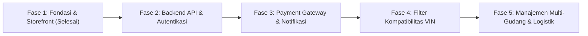

# Roadmap & Catatan Perencanaan Pengembangan (AutoPart Central)

Dokumen ini memetakan tahapan rilis, prioritas fitur, dan rencana pengembangan teknis untuk proyek AutoPart Central dari tahap purwarupa (MVP) hingga sistem produksi skala penuh.

---

## Ringkasan Tahapan Pengembangan

---

## Fase 1: Fondasi, Desain Sistem & Storefront UI *(Status: Selesai)*

Fokus utama adalah menyiapkan arsitektur frontend yang rapi, cepat, dan teruji secara tampilan serta UX:
- [x] Inisialisasi Vite 8 + React 19 + TypeScript + Tailwind CSS v4.
- [x] Integrasi UI library shadcn/ui dengan Nova styling preset dan ikon Lucide React.
- [x] Setup pipeline Turborepo (`turbo.json`) untuk task `build`, `lint`, dan `typecheck`.
- [x] Pembuatan data model TypeScript terstruktur di `src/types/` (`product.ts`, `cart.ts`, `order.ts`).
- [x] Sentralisasi mock data katalog suku cadang di `src/constans/`.
- [x] Pembuatan Global State Management Keranjang (`cart-context.tsx`) terhubung `localStorage` dan Sonner toast.
- [x] Pemisahan komponen reusable (`ProductCard`, `CartSheet`, `CheckoutDialog`, `ErrorBoundary`) ke `src/components/common/`.
- [x] Halaman Katalog Storefront (`src/pages/web.tsx`) dengan filter kategori, brand, search, dan sorting.
- [x] Mobile Navigation Drawer solid non-transparan dengan backdrop overlay gelap.
- [x] Halaman Login Admin ergonomis (`src/pages/auth/login.tsx`) dengan toggle password dan demo credentials.
- [x] Halaman Dashboard Manajemen Stok (`src/pages/dashboard.tsx`) dengan KPI cards dan tabel inventaris.

---

## Fase 2: Backend REST API & Autentikasi Nyata *(Tahap Berikutnya)*

Mengganti dummy data statis dengan komunikasi API server nyata:
- [ ] **API Client Setup**:
  - Konfigurasi HTTP Client berbasis `Axios` atau native `fetch` wrapper dengan request/response interceptors.
  - Penanganan token JWT otomatis (*Bearer Authorization*) dan handling error response `401 Unauthorized`.
- [ ] **Sistem Autentikasi & Session**:
  - Endpoint `/api/auth/login`, `/api/auth/logout`, dan `/api/auth/me`.
  - Role-based Access Control (RBAC): Membedakan role `Admin Gudang`, `Kasir/Sales`, dan `Customer`.
  - Proteksi rute dashboard melalui `ProtectedRoute` wrapper component.
- [ ] **Katalog & Inventory CRUD Endpoints**:
  - Endpoint GET `/api/products` dengan server-side pagination, search, dan multi-filter.
  - Endpoint POST/PUT/DELETE `/api/products` untuk tambah/edit stok sparepart beserta upload gambar produk.
  - Validasi payload input menggunakan skema `Zod`.

---

## Fase 3: Transaksi, Payment Gateway & Notifikasi Otomatis

Menjadikan alur checkout berfungsi secara komersial:
- [ ] **Integrasi Payment Gateway**:
  - Menghubungkan proses checkout dengan Payment Gateway resmi Indonesia (Midtrans Snap API atau Xendit Invoice).
  - Pilihan metode bayar otomatis: QRIS Instan (GoPay, OVO, Dana), Virtual Account Bank (BCA, Mandiri, BRI, BNI), dan COD.
- [ ] **Webhook Listener**:
  - Menerima callback status pembayaran (`settlement`, `pending`, `expire`, `cancel`).
  - Update status pesanan secara real-time pada dashboard admin.
- [ ] **Notifikasi Transaksi WhatsApp**:
  - Mengirim invoice digital dan detail pesanan ke WhatsApp pembeli segera setelah checkout berhasil.
  - Mengirim alert instan ke grup logistik gudang untuk pemrosesan suku cadang yang telah dibayar.

---

## Fase 4: Filter Kompatibilitas Kendaraan Canggih (VIN & Part Matching)

Memberikan kemudahan maksimal bagi pemilik mobil menemukan part yang 100% pas:
- [ ] **Pencarian Berdasarkan Nomor Rangka (VIN Decoder)**:
  - Input 17 digit VIN mobil untuk mendeteksi tipe mesin, kode bodi, dan tahun rakitan secara akurat.
- [ ] **Filter Bertingkat Terintegrasi**:
  - Pemilihan berurutan: `Merk Mobil` &rarr; `Model` &rarr; `Tahun Pembuatan` &rarr; `Varian Mesin/Transmisi`.
- [ ] **Badge Jaminan Kompatibilitas (*Fitment Guarantee*)**:
  - Indikator hijau visual *"Pasti Pas untuk Mobil Anda"* di setiap card produk jika kendaraan pengguna sesuai dengan katalog.

---

## Fase 5: Manajemen Multi-Gudang & Operasional Logistik

Mendukung operasional toko offline dan pergudangan fisik skala besar:
- [ ] **Pelacakan Lokasi Rak & Multi-Warehouse**:
  - Catatan lokasi rak penyimpanan sparepart (contoh: *Gudang Cikarang - Rak B3-04*).
- [ ] **Manajemen Mutasi Stok & Stock Opname**:
  - Riwayat barang masuk (inbound vendor), barang keluar (order penjualan), dan penyesuaian selisih fisik (*opname*).
  - Peringatan stok menipis (*low stock warning threshold*).
- [ ] **Cetak Dokumen Pengiriman**:
  - Generator Surat Jalan, Label Resi Pengiriman (Barcode/QR), dan Cetak Invoice PDF resmi.
